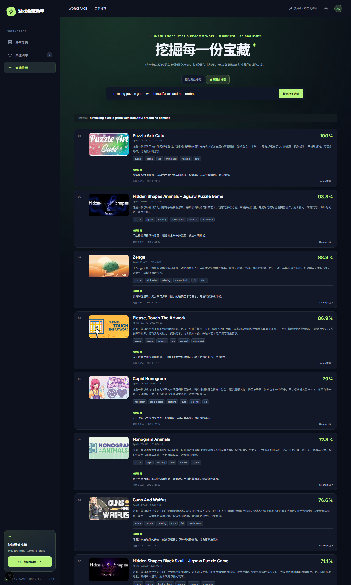
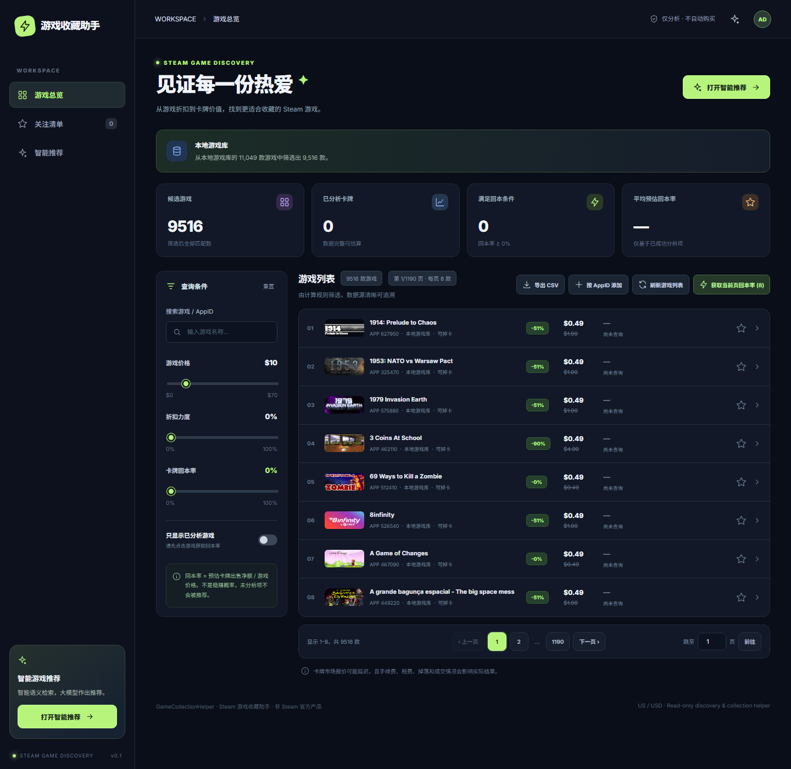

# 实验结果与运行截图

本目录是给报告直接引用的**实测材料**：截图、接口返回、流水线日志、消融实验数据。
所有数字都来自 `data-v1` 发布的那份 30,000 条索引与本机实际运行，不是估算。

环境：Windows 11 / RTX 4060 Laptop / Docker Desktop（Qdrant `v1.20.2`）/
BGE-M3（CUDA, float16）/ 网关模型 `CS5351/DeepSeek-V4-Flash`。

---

## 1. 运行规模确认

| 项 | 值 | 来源 |
| --- | --- | --- |
| Qdrant 点数 | **30,000** | `/status`、`/collections/steam_games` |
| 向量维度 / 距离 | **1024** / Cosine | 同上 |
| 本轮新增强的条目 | **9,890**（5,000 + 4,890） | 两批 `enrich_qdrant` 日志 |
| 增强失败 / 被限流丢弃 | **0** | 点数增量与 `[ENRICH]` 计数完全一致 |
| 累计 LLM 调用 | 9,890 次 | `[USAGE] llm_calls` |
| 累计 tokens | 5,645,749 prompt + 1,283,556 completion = **6.93 M** | `[USAGE]` |
| 可用候选池（评论数 ≥20） | 46,018 | `dataset_stats` |
| 每条平均 LLM 标签数 | ~10 | 抽样 300 条统计 |
| 无描述条目 | 54 / 25,110（0.215%） | 源 CSV 的 `About the game` 为空 |

> 30,000 = 早期按 CSV 行序抽取的 20,110 条 + 按评论数降序补入的 9,890 条。
> 后者正是为了修掉"热门游戏查不到"的问题（见 `docs/gap-analysis.md` §10）。

---

## 2. 智能推荐页面截图

页面：<http://localhost:3000/recommend>。地址栏支持 `?q=&mode=` 直接出结果
（`mode=similar` 相似游戏 / `mode=search` 自然语言），便于复现与截图。

### 2.1 相似游戏搜索（输入 Stardew Valley）


页头显示「向量库已就绪 · 30,000 款游戏」；参照物 `Stardew Valley`（AppID 413150），
Top-8 全部是同类型的农场经营/生活模拟，卡片内含 LLM 摘要、标签、
推荐原因，以及每条结果的向量分与 BM25 分。

### 2.2 自然语言搜索

查询：`a relaxing puzzle game with beautiful art and no combat`（题目原文示例）



Top-8 全部是拼图 / 逻辑解谜类，且都符合"无战斗、美术向、放松"的语义约束。
注意这些结果的 BM25 分很低（约 11–17），说明主要靠语义向量命中。

### 2.3 总览页（`games.csv` 目录）



11,049 款可筛选游戏（含 Steam 交易卡牌、价格 0–70 USD 区间），服务端分页。

---

## 3. Qdrant 实际数据量与向量维度

`GET http://127.0.0.1:8000/status`：

```json
{
  "ready": true,
  "collection": "steam_games",
  "documents": 30000,
  "vector_size": 1024,
  "llm_explanations": true,
  "chat_model": "CS5351/DeepSeek-V4-Flash"
}
```

其中 `embedding` 段：

```json
{"model": "BAAI/bge-m3", "revision": "b28ce2a6...", "dimension": 1024,
 "device": "cuda", "dtype": "float16", "max_seq_length": 1024, "batch_size": 4}
```

Qdrant 侧独立核对：

```bash
curl http://127.0.0.1:6333/collections/steam_games
# → points_count: 30000, config.params.vectors.size: 1024, distance: Cosine
```

容器冷启动（重建 BM25 倒排索引 + 载入 3 万条 payload）耗时：**43–64 s**；
温态 `/search` 检索本身 p50 **0.30 s**。

---

## 4. DeepSeek 生成标签/摘要 + BGE-M3 生成向量（日志）

`python scripts/pipeline_demo.py --appid 570` 会把单款游戏完整走一遍两个阶段：

```text
STAGE 0 · 清洗后的记录（送入 LLM 与嵌入的原料）
  app_id           : 570
  name             : Dota 2
  genres           : ['Action', 'Strategy', 'Free To Play']
  source_tags      : ['Free to Play', 'MOBA', 'Multiplayer', 'Strategy', 'e-sports', ...]
  developers       : ['Valve']
  review_count     : 2,498,969
  description len  : 1,402 chars

STAGE 1 · DeepSeek（deepseek / CS5351/DeepSeek-V4-Flash）生成标签与摘要
  latency          : 3.65s
  tags (12)        : ['MOBA', '免费游玩', '多人', '团队竞技', '策略', '动作', '电子竞技',
                      'PvP', '合作', '奇幻', '角色定制', '高重复可玩性']
  summary          : Dota 2 是一款免费多人在线战术竞技游戏，玩家从百余位英雄中选择角色，
                     在团队对抗中运用技能与物品策略。支持合作对抗机器人、英雄演示和基于
                     行为与技术的匹配系统，强调竞技平衡与无限可能性。
  tokens           : prompt=543 completion=113

STAGE 2 · BGE-M3 生成向量（BAAI/bge-m3 · cuda · float16）
  input chars      : 1,856
  latency          : 0.04s          ← 模型已预热，为单条真实成本
  dimension        : 1024
  L2 norm          : 0.999965       ← 归一化向量，可直接做余弦相似度
  first 6 values   : [-0.00329, -0.02719, -0.04681, 0.03409, 0.00106, -0.01223]

[DONE] Dota 2 · tags=12 · summary=94 chars · vector=1024d · total=3.69s
```

> 两次运行标签数会是 10 或 12：网关 `temperature=0.2`，同一游戏不保证完全一致。
> 首次加载 2.2 GB 权重约需 28 s，脚本会先预热再计时，避免把加载算成单条成本。

---

## 5. 推荐解释确实调用了 DeepSeek

两种独立证据。

### 5.1 网关配额计数（最硬的证据）

在**一次** `/search` 前后各打一次网关探针，读取 LiteLLM 返回的
`x-ratelimit-team_member-remaining-requests`：

```text
探针 A 之后 remaining = 43
/search 之后remaining = 41   （探针 B 自身占 1）
=> 一次 /search 消耗网关请求数 = 1
```

`explain_results()` 每次请求只批量调用一次 LLM，所以"1 次请求 = 1 次网关调用"正好对上。
若走的是本地标签回退，这个计数不会变化。

### 5.2 解释文本不是回退模板

回退实现的文案是固定的（`与当前游戏共享 … 等特征，并同时命中词法与语义检索。` /
`游戏内容在向量空间中较为接近…`）。实测 5 条解释中**含回退模板的数量 = 0**，且文本随查询变化：

```text
1. 这是一款轻松的后末日生存模拟游戏，玩家在废弃屋顶上种植作物、建造基地，并指挥机器人自动完成杂务，无压力环境适合放松。
2. 这款农场模拟游戏让玩家从零开始建立农场，种植果蔬、饲养动物，整体节奏轻松，适合休闲经营。
3. 在这款轻松的农场商店模拟游戏中，玩家经营农场商店，无时间限制，适合短时间游玩，放松身心。
4. 这是一款开放世界农场模拟游戏，提供种植、饲养、钓鱼等多种活动，体验环保与休闲的乡村生活。
5. 在魔法玩具中经营迷你花园，无分数与时间限制，可自由实验，适合放松与创意发挥。
```

---

## 6. BM25 / Vector / Hybrid 三路对比

复现命令（10 条查询 × 3 种模式 = 30 次请求）：

```bash
python scripts/experiment_retrieval.py --k 10
```

`/search` 新增 `retrieval=hybrid|vector|bm25` 参数（默认 `hybrid`）。
单路模式关闭质量重排，保留该检索器自身的顺序，否则比较就不是"检索"了。

### 6.1 聚合指标（k=10，30,000 条库，10 条查询平均）

| 指标 | BM25 only | Vector only | Hybrid (RRF) |
| --- | --- | --- | --- |
| **Hit@10** | 1.000 | 1.000 | 1.000 |
| **Precision@10** | 0.920 | 0.820 | **0.940** |
| **Recall@10** | 0.920 | 0.820 | **0.940** |
| **MRR@10** | 1.000 | 1.000 | 0.950 |
| **nDCG@10** | 0.929 | 0.836 | **0.938** |
| p50 延迟 | 2.78 s | 3.09 s | 2.73 s |

指标定义（二值相关）：
`Hit@k` = 前 k 条里至少 1 条相关；`Precision@k` = 命中数 / k；
`Recall@k` = 命中数 / min(k, 相关集大小)；`MRR@k` = 首个相关结果的 1/rank；
`nDCG@k` = 二值增益的归一化折损累计增益。

### 6.2 两路结果差异极大

平均 Jaccard 重叠（前 10 条）：

| 组合 | 重叠度 |
| --- | --- |
| BM25 ∩ Vector | **0.092** |
| BM25 ∩ Hybrid | 0.288 |
| Vector ∩ Hybrid | 0.278 |

两种检索器几乎不重样，这正是融合的价值所在：Hybrid 的 Precision 反而高于任一单路
（0.940 vs 0.920 / 0.820），因为它能把词法精确命中与语义近邻同时收进来。

### 6.3 逐查询明细

| 相关集 | 查询 | BM25 P@10 | Vector P@10 | Hybrid P@10 |
| --- | --- | --- | --- | --- |
| 3,598 | a relaxing puzzle game with beautiful art and no combat | 0.90 | 0.90 | **1.00** |
| 447 | cozy farming simulation to unwind | 0.80 | 0.70 | **1.00** |
| 343 | souls-like action rpg with punishing combat | **0.90** | 0.50 | 0.90 |
| 842 | story rich visual novel with romance | **0.80** | 0.40 | 0.60 |
| 1,627 | cold war military strategy wargame | 1.00 | 1.00 | 1.00 |
| 417 | roguelike deckbuilder with card battles | 1.00 | 1.00 | 1.00 |
| 4,078 | horror exploration in a dark asylum | **0.90** | 0.80 | 0.90 |
| 914 | space simulation trading and exploration | 1.00 | 1.00 | 1.00 |
| 2,063 | multiplayer tactical shooter with teamwork | 0.90 | 0.90 | **1.00** |
| 2,505 | city building management with economic depth | 1.00 | 1.00 | 1.00 |

完整数据（含每个查询返回的 AppID 列表）：`docs/experiments/retrieval-ablation.json`。

### 6.4 结果怎么读，以及它的局限

- **Hybrid 在 3/10 查询上严格优于两个单路**，在其余查询上持平于较好的那一路；
  平均 Precision 0.940 > BM25 0.920 > Vector 0.820。
- **MRR 从 1.000 掉到 0.950**：融合偶尔会把一个相关的语义近邻排到词法精确命中之前。
  这是 RRF 的固有取舍，值得在报告里如实写出，而不是只报好消息。
- **标签是规则代理，不是人工标注**：相关集由 genres / source_tags / llm_tags / summary 里的
  关键词规则判定。这些词面同时也在 BM25 的索引里，**因此结果系统性偏向 BM25**。
  Vector 只拿到 0.820，部分原因是语义相关但用词不同的物品规则判不出来。
  想得到无偏数字，需要人工标注一批 query-document 对，这一步还没做。
- 单路模式关闭了质量重排（贝叶斯好评率 + 热度），Hybrid 保留了它；这就是
  Hybrid 在延迟上没变慢（2.73 s，还略低于纯向量）的原因——多了一路候选但省了一次
  模型前向之外的额外开销差异不大，主要由 LLM 解释调用主导。

---

## 7. 复现步骤

```bash
# 前置：30,000 条索引（见 Release data-v1）与 games.csv
docker compose up -d qdrant          # 向量库
npm run recommend:api                # 或容器内运行；本机用 venv 走 CUDA 更快

python scripts/pipeline_demo.py --appid 570   # 单条流水线日志
python scripts/experiment_retrieval.py        # 三路对比与指标
python scripts/acceptance_test.py             # 27 项要求级验收
```

截图流程：`/recommend?mode=similar&q=<游戏名>` 与
`/recommend?mode=search&q=<自然语言>`，用无头 Edge 按 1440 宽截图。
